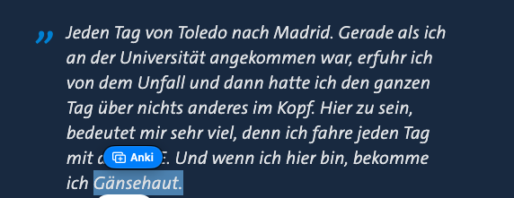
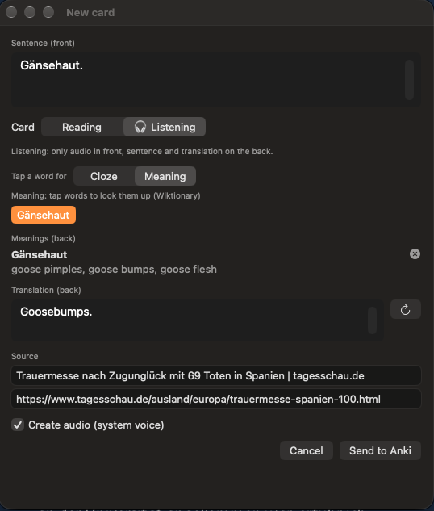
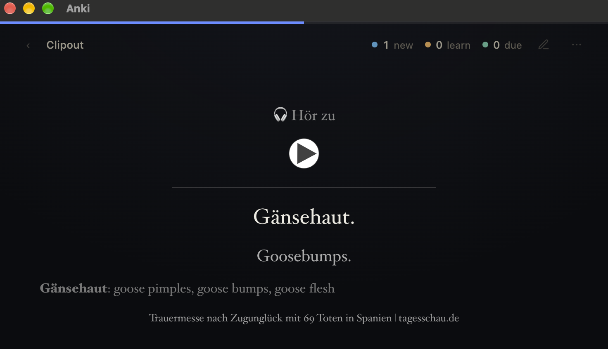
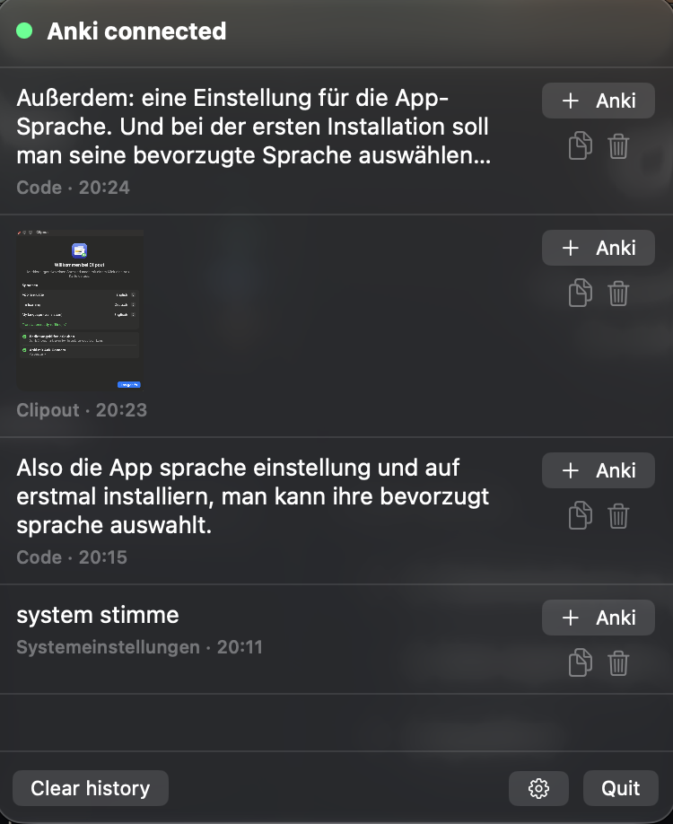
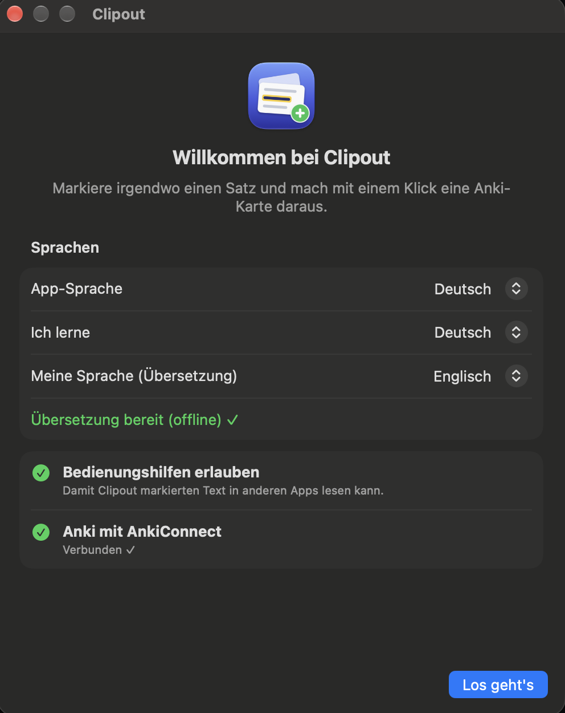
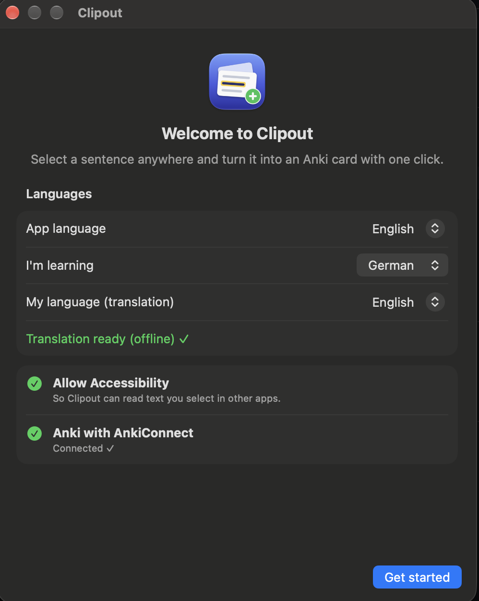
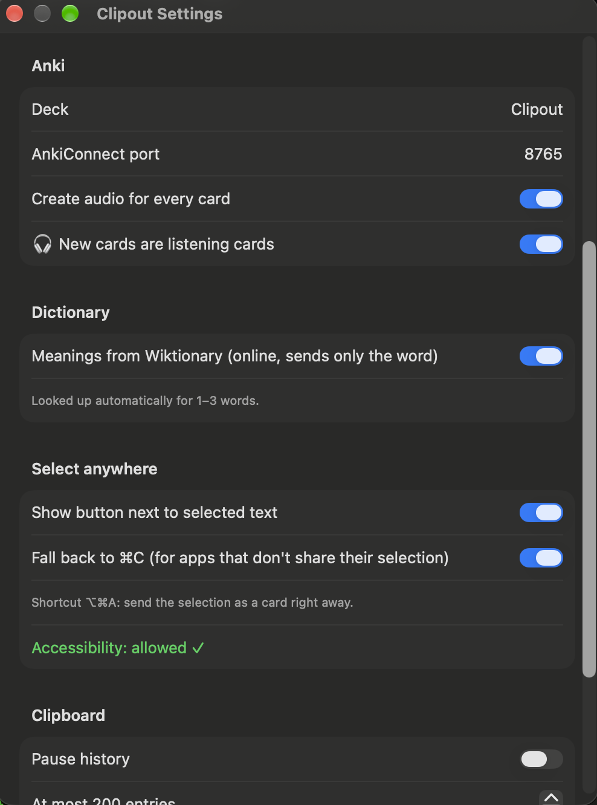
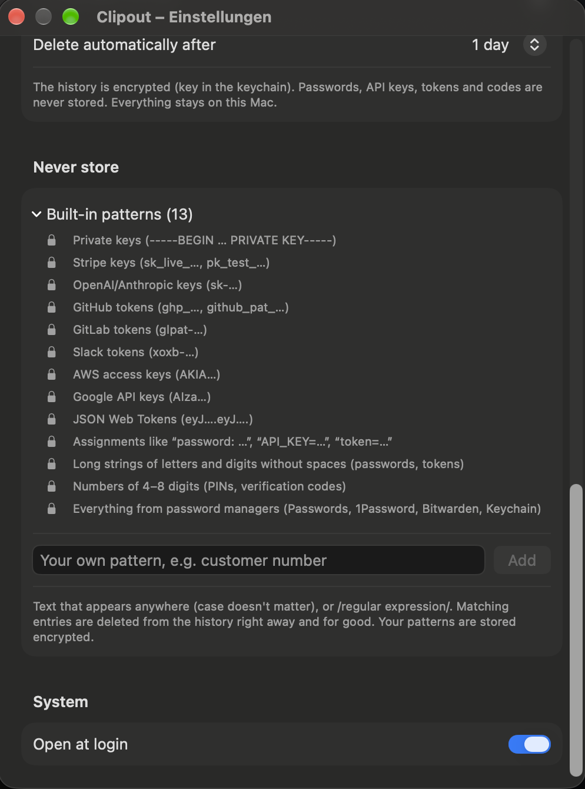

# Clipout

Select a sentence anywhere on your Mac (in Chrome, Safari, a PDF or any other app) and turn it into an Anki card with one click.

- **Front:** the sentence
- **Back:** translation, audio and source

## Download

**[⬇︎ Download Clipout for Mac (.dmg)](https://github.com/ihonomic/clipout/releases/latest/download/Clipout.dmg)**

Needs macOS 26 or later (Apple Silicon or Intel) and [Anki](https://apps.ankiweb.net) with the [AnkiConnect](https://ankiweb.net/shared/info/2055492159) add-on.

1. Open the .dmg and drag **Clipout** onto **Applications**.
2. Open Clipout. macOS blocks the first launch because Clipout isn't from an identified developer (it isn't notarized by Apple). Go to **System Settings → Privacy & Security**, scroll down and click **Open Anyway** next to Clipout. You only do this once.
3. The welcome window guides you through the rest: languages, the Accessibility permission and the Anki connection.

## How it works

<p align="center">
  
</p>
<p align="center"><em>1. Select a word or sentence anywhere; a “+ Anki” button appears next to it.</em></p>

<p align="center">
  
</p>
<p align="center"><em>2. Check the card: translation, Wiktionary meaning, source and audio are filled in for you.</em></p>

<p align="center">
  
</p>
<p align="center"><em>3. The card is in Anki: here a listening card with audio in front; sentence, translation, meaning and source on the back.</em></p>

## Screenshots

<p align="center">
  
</p>
<p align="center"><em>Menu bar: Anki status and clipboard history, every entry with “+ Anki”</em></p>

<p align="center">
  
  &nbsp;
  
</p>
<p align="center"><em>First start: choose the app language, the language you learn and your own language, then check Accessibility and Anki (German and English)</em></p>

<p align="center">
  
  &nbsp;
  
</p>
<p align="center"><em>Settings: deck, listening cards, dictionary, select anywhere (left); history deleted after 24 hours, built-in and your own “never store” patterns (right)</em></p>

## Features

- **Button next to a selection:** after you select text, a small “+ Anki” appears next to it. Clicking it opens the “New card” window.
- **⌥⌘A:** sends the selection as a card right away, without a window.
- **Clipboard history:** the menu bar icon lists everything you copied, text and images. Every row has a “+ Anki” button.
- **Translation:** Apple's on-device translation, offline and free.
- **Audio:** the system voice reads the sentence. The recording goes on the back as .m4a.
- **Cloze:** tap words in the window to hide them, and the card becomes a cloze card.
- **Dictionary:** in “Meaning” mode, tap a word and its meaning from the English Wiktionary goes on the back. Inflected forms are resolved (“Abstimmungen” → “Abstimmung”). For 1–3 selected words this happens automatically. Online, only the word is sent. Can be switched off.
- **Listening cards:** “🎧 Listening” in the card window (or as the default in Settings). Only audio in front; sentence, translation and meanings on the back.
- **App language:** German or English. On first start, a welcome window asks for the app language, the language you learn and your own language.
- **Images:**
  - A screenshot (⌘⇧⌃4 copies it) becomes a card with the image.
  - The text in the image is recognized automatically.
- **Source:** in Chrome, Safari, Arc, Brave and Edge the page URL goes on the card. In other apps it's the window title.
- **Queue:** when Anki is closed, Clipout keeps the cards and sends them as soon as Anki is open. Errors (for example an open edit window in Anki) are shown in the menu.
- **Privacy and security:**
  - The clipboard history, its images and the card queue are **encrypted** (AES-256-GCM). The key is in your login keychain, so the files are useless to other programs and in backups.
  - Passwords, API keys, tokens, private keys and one-time codes are **never stored**: entries from password managers and anything that looks like a secret are skipped.
  - Entries are deleted automatically after 24 hours by default (or after 7 days, 30 days or never; see Settings).
  - **Never store:** Settings list the built-in patterns (locked) and let you add your own: plain text such as a customer number, or a `/regular expression/`. Adding a pattern also deletes matching entries already in the history, for good; there is no undo. Your patterns are stored encrypted.
  - Everything stays on your Mac. Only dictionary lookups go online (just the word, to Wiktionary) and can be switched off.
  - The app runs with the Hardened Runtime, so no other program can inject code into it and misuse its Accessibility permission.

## Requirements

- macOS 26 or later
- Anki with the [AnkiConnect](https://ankiweb.net/shared/info/2055492159) add-on
- Swift (the Command Line Tools are enough, Xcode is not needed)

## Build and run

```bash
./build.sh --open     # builds build/Clipout.app and starts it
./test.sh             # tests
```

On first start:

1. **Allow Accessibility:** System Settings → Privacy & Security → Accessibility → switch Clipout on. Without it, only the clipboard history works.
2. **Download the language pack:** Clipout menu → ⚙︎ → “Download language pack”, once.
3. **Allow Automation:** the first time in Chrome or Safari, macOS asks whether Clipout may control the browser. Clipout only needs this for the URL.

### Once: a fixed certificate, so the permission survives rebuilds

macOS ties the Accessibility permission to the app's signature. Without a certificate the signature changes with every `./build.sh` and the permission stops working (the list still shows Clipout as switched on).

1. `./make-cert.sh` creates the certificate `Clipout Dev` in the login keychain. Recent macOS versions no longer offer Keychain Access's certificate assistant, so the script does it from the command line.
2. `./build.sh --open`. The script finds the certificate. If macOS asks for your login password, choose **“Always Allow”**.
3. In Accessibility, remove the old Clipout entry with `−`, add `build/Clipout.app` with `+` and switch it on. You never need to do this again.

### Share as .dmg

```bash
./make-dmg.sh         # → build/Clipout.dmg
```

Clipout is signed with its own certificate, not with an Apple Developer ID, and not notarized. On another Mac, macOS therefore blocks the first launch; the user allows it once under System Settings → Privacy & Security → **Open Anyway** (right-click → Open no longer skips this since macOS 15).


## Anki

Clipout creates:

- the deck **Clipout**
- the note types **Clipout** (sentence → translation) and **Clipout Cloze**, with these fields:

| Field | Contents |
|---|---|
| `Sentence` (`Text` in Clipout Cloze) | the sentence in your target language, the language you learn |
| `Translation` | the translation into your own language |
| `Audio` | the sentence read by the system voice |
| `Image` | the image, for cards made from screenshots |
| `Source` | the page or app the text came from |
| `Meaning` | Wiktionary meanings of the words you tapped |
| `Listening` | filled for listening cards: then only the audio is on the front |

Clipout works for any language pair Apple's translation supports; set “I'm learning” and “Translate into” in Settings.

Cards made with 0.1.x: Clipout renames their German fields (Satz, Übersetzung, …) to the names above when it starts, and the content stays. The cloze note type keeps its old name “Clipout Lücke”, because AnkiConnect can't rename note types; you can rename it to “Clipout Cloze” in Anki under Tools → Manage Note Types.

All cards have the tag `clipout`.

## Your data

Everything Clipout keeps lives in `~/Library/Application Support/Clipout` (readable only by you) and is encrypted with a key from your login keychain:

| File | Contents |
|---|---|
| `history.sealed` | clipboard history |
| `clips/*.sealed` | copied images |
| `queue.sealed` | cards waiting for Anki |
| `patterns.sealed` | your own “never store” patterns |
| `media/` | audio and images briefly, until Anki has them |

To remove everything, quit Clipout and run:

```bash
rm -rf ~/Library/Application\ Support/Clipout
security delete-generic-password -s com.ihonomic.clipout -a storage-key
defaults delete com.ihonomic.clipout
```

## Structure

| Folder | Contents |
|---|---|
| `Sources/ClipoutCore` | Logic without UI: building cards, cloze, history and expiry, secret detection and custom patterns, Wiktionary parsing, AnkiConnect messages. Tested in `Tests/`. |
| `Sources/Clipout` | The app: menu bar, reading the selection, floating button, windows, translation, audio, Anki queue, encrypted storage. |
| `Resources` | `Info.plist`, entitlements and `make-icon.swift`, which draws the app icon. |
| `build.sh`, `make-dmg.sh`, `make-cert.sh`, `test.sh` | Build the app, build the .dmg, create the signing certificate, run the tests. |

## Changelog

**0.1.1**
- Note types use English, language-neutral field names (Sentence, Translation, Audio, Image, Source, Meaning, Listening); existing fields are renamed, content stays.
- Clipboard history, images, queue and patterns are encrypted (AES-256-GCM, key in the keychain).
- Passwords, API keys, tokens, private keys and one-time codes are never stored.
- “Never store”: built-in patterns shown in Settings, plus your own (text or `/regex/`).
- History entries are deleted after 24 hours by default.
- Hardened Runtime; only `http(s)` links on cards; private file permissions.
- Fixed: audio from enhanced system voices was cut off or could not be played.

**0.1.0**
- First release (universal binary: Apple Silicon and Intel).
