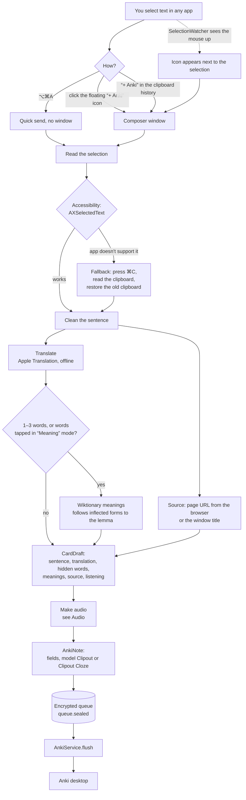
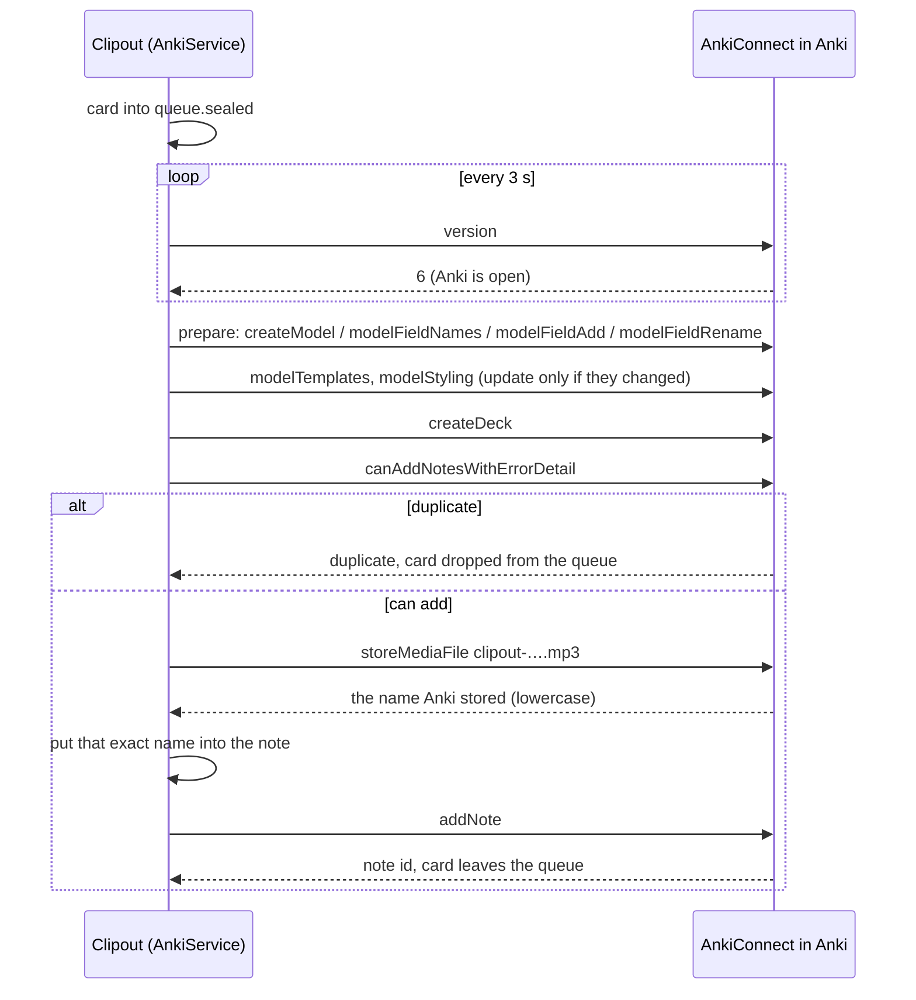
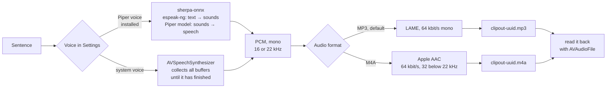
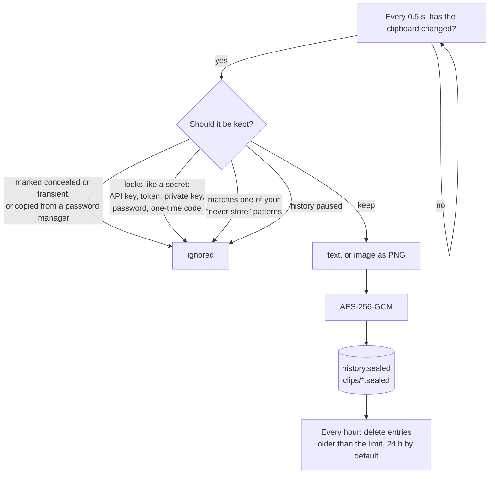
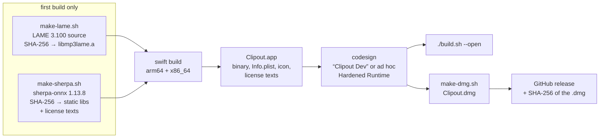

# How Clipout works

This document explains how Clipout is built and how its parts work together, from selected text to a card that plays on every Anki device. It is meant for contributors and anyone curious about what the app does on their Mac. For using Clipout, see the [README](../README.md).

- [The big picture](#the-big-picture)
- [From selection to Anki card](#from-selection-to-anki-card)
- [Audio](#audio)
- [The card in Anki](#the-card-in-anki)
- [Clipboard history](#clipboard-history)
- [Storage and security](#storage-and-security)
- [What goes over the network](#what-goes-over-the-network)
- [Code map](#code-map)
- [Build and release](#build-and-release)
- [Command-line tools](#command-line-tools)
- [Third-party code and licenses](#third-party-code-and-licenses)

## The big picture

Clipout is a menu bar app. It reads text you select in any app, turns it into a card and hands the card to Anki on the same Mac. Anki's own sync then carries the card to AnkiWeb and your phone. Clipout never talks to AnkiWeb itself.

```
┌──────────────────────────────── your Mac ─────────────────────────────────┐
│                                                                           │
│   Chrome, Safari, Preview,        ┌───────────── Clipout ──────────────┐  │
│   Mail, any app                   │  menu bar · floating “+ Anki” icon │  │
│   ┌──────────────────┐ selection  │  ⌥⌘A · clipboard history           │  │
│   │ Der Film fängt   │──────────▶ │                                    │  │
│   │ um acht an.      │ clipboard  │  translate ─ explain ─ speak ─ MP3 │  │
│   └──────────────────┘──────────▶ │                                    │  │
│                                   │  encrypted queue                   │  │
│                                   └──────────────┬─────────────────────┘  │
│                                                  │ AnkiConnect            │
│   Apple frameworks, all offline:                 │ http://127.0.0.1:8765  │
│   Translation · Vision (OCR) ·                   ▼                        │
│   AVSpeech · CryptoKit · Keychain   ┌──────── Anki desktop ──────────┐    │
│                                     │  deck “Clipout”, note types    │    │
│                                     │  collection.media/*.mp3        │    │
│                                     └──────────────┬─────────────────┘    │
└────────────────────────────────────────────────────┼──────────────────────┘
                                                     │ Anki sync
                         ┌───────────────────────────┼──────────────────┐
                         ▼                           ▼                  ▼
                    ┌─────────┐                ┌───────────┐     ┌─────────────┐
                    │ AnkiWeb │                │ AnkiDroid │     │ AnkiMobile  │
                    └─────────┘                └───────────┘     └─────────────┘

   Optional, outside the Mac:
   en.wiktionary.org ◀── one word, for meanings
   github.com        ◀── a Piper voice, once, when you download it
```

## From selection to Anki card

There are three ways in. All end in the same pipeline.



In the composer you can still change everything before sending: tap words to hide them (the card becomes a cloze card), switch to “Meaning” mode and tap words to get their meanings, turn the audio or the listening card on or off.

### Sending to Anki

Clipout never sends a card straight away. Every card goes into the encrypted queue first, so nothing is lost when Anki is closed. `AnkiService` checks every 3 seconds whether Anki answers, and empties the queue when it does.



Two details matter here:

- **The note type is kept up to date.** Templates and styling are only rewritten when they differ, so Anki doesn't ask for a full sync after every start. Older field names (Satz, Übersetzung, …) are renamed, so the content stays.
- **Media names follow Anki.** AnkiConnect stores `clipout-AB12.mp3` as `clipout-ab12.mp3`. The Mac doesn't care about case, but AnkiWeb does: with the wrong case it finds no file and shows no play button. Clipout therefore uses lowercase names and writes the name Anki reports into the note.

## Audio



- **MP3 is the default** because AnkiWeb plays nothing else. macOS can't write MP3, so Clipout contains LAME.
- **Piper voices** sound more natural than most system voices. They are not shipped with Clipout. Settings → Neural voices downloads one from sherpa-onnx's GitHub releases (27–116 MB), checks it against a SHA-256 written into Clipout's code, and unpacks it into `voices/<voice>`. Each download contains the model, its tokens and the espeak-ng data. The last used voice stays loaded, so a card takes about a second.
- **System voices** deliver their audio in several buffers. Clipout collects all of them before writing the file; writing while the voice was still speaking broke the files of enhanced voices.
- Every file is read back before it goes to Anki. A file that can't be read is not sent.

## The card in Anki

Clipout creates two note types and the deck you set (default `Clipout`):

| Field | Contents |
|---|---|
| `Sentence` (`Text` in the cloze type) | the sentence, with cloze gaps if you hid words |
| `Translation` | the translation into your language |
| `Audio` | `[sound:clipout-….mp3]` |
| `Image` | a screenshot, if the card came from an image |
| `Source` | a link to the page (only `http`/`https`) or the app's window title |
| `Meaning` | Wiktionary meanings of the words you chose |
| `Listening` | `yes` for listening cards |

The template reads `Listening`: a listening card shows only the audio in front (`🎧`) and the sentence on the back. Everything inserted into a field is HTML-escaped first.

## Clipboard history



Adding a “never store” pattern also deletes matching entries already in the history, for good.

## Storage and security

Everything lives in `~/Library/Application Support/Clipout`. Folders are `0700`, files `0600`.

| Path | Contents | Encrypted |
|---|---|---|
| `history.sealed` | clipboard history | yes |
| `clips/*.sealed` | copied images | yes |
| `queue.sealed` | cards waiting for Anki | yes |
| `patterns.sealed` | your “never store” patterns | yes |
| `media/` | audio and images, only until Anki has them | no, deleted after sending |
| `voices/` | downloaded Piper voices | no (public models) |

```
   login keychain                       ~/Library/Application Support/Clipout
 ┌──────────────────────┐             ┌──────────────────────────────────────┐
 │ com.ihonomic.clipout │  256-bit    │ history.sealed  queue.sealed         │
 │ “storage-key”        │────key────▶ │ patterns.sealed clips/*.sealed       │
 │ only on this Mac,    │  AES-GCM    │ (useless without the key: in backups,│
 │ only when unlocked   │             │  to other apps, on another Mac)      │
 └──────────────────────┘             └──────────────────────────────────────┘
```

Clipout reads other apps' text, so the app itself is protected too:

- **Hardened Runtime.** No other program can inject code into Clipout (for example with `DYLD_INSERT_LIBRARIES`) and use its Accessibility permission.
- **Everything is linked statically.** The Hardened Runtime only loads libraries signed by the same team, and a self-signed certificate has none. Switching that check off would let a swapped library run with Clipout's permissions, so LAME and sherpa-onnx are built into the binary.
- **Fixed signature.** The Accessibility permission is tied to the signature. `make-cert.sh` creates the certificate “Clipout Dev” once, so the permission survives rebuilds.
- **Permissions it asks for:** Accessibility (read the selection), Automation (only to ask the browser for the page URL). Nothing else.

## What goes over the network

| When | To | What is sent |
|---|---|---|
| You make a card with meanings (can be switched off) | `en.wiktionary.org` | the single word, nothing else |
| You download a Piper voice | `github.com` (sherpa-onnx releases) | a normal download request |
| Every 3 s | `127.0.0.1:8765` (Anki on the same Mac) | cards, only to Anki locally |
| Building the app | GitHub, SourceForge or Debian | downloads of sherpa-onnx and LAME, checksum verified |

Translation, speech, OCR and encryption run on the Mac. Clipout has no account, no analytics and no server of its own.

## Code map

```
Sources/
├── ClipoutCore/            logic without UI, covered by Tests/
│   ├── Sentence.swift      cleaning, words, cloze HTML, HTML escaping
│   ├── Card.swift          CardDraft → AnkiNote, note types, templates, migration
│   ├── History.swift       history entries, expiry, secret detection, patterns
│   ├── Dictionary.swift    Wiktionary parsing, inflected form → lemma
│   └── AnkiConnect.swift   request/response types, error explanations
├── CSherpaOnnx/            C interface of sherpa-onnx (header only)
└── Clipout/                the app
    ├── ClipoutApp.swift    entry point, command-line tools
    ├── AppController.swift wires everything, quick send, windows
    ├── Selection.swift     reading the selection, ⌘C fallback, mouse watcher
    ├── Panels.swift        floating icon, toast
    ├── Composer.swift      the “New card” window
    ├── Views.swift         menu, settings, welcome window
    ├── AnkiService.swift   queue, preparing Anki, sending
    ├── ClipboardMonitor.swift  clipboard history
    ├── PatternStore.swift  “never store” patterns
    ├── Helpers.swift       translation, system voices, OCR, browser URL, hotkey, Wiktionary lookup
    ├── Piper.swift         Piper voices: catalog, download, speaking
    ├── MP3.swift           LAME
    ├── Storage.swift       paths, settings, keychain, encrypted files
    ├── L10n.swift          German and English UI text
    └── SelfTest.swift      --selftest, --repair-audio, --convert-audio
```

## Build and release



`./test.sh` runs the tests of `ClipoutCore`. Everything that needs AppKit, Anki or the voices is covered by `--selftest` instead, against the real services on the Mac.

## Command-line tools

The app binary doubles as a small toolbox: `build/Clipout.app/Contents/MacOS/Clipout <option>`.

| Option | What it does |
|---|---|
| `--selftest` | checks Anki, translation, dictionary, audio, encryption and patterns, and prints the result |
| `--selftest --send` | also sends a test card to Anki, reads it back and deletes it |
| `--install-voice <id>` | downloads a Piper voice, e.g. `de_DE-thorsten-high` |
| `--repair-audio` | speaks the audio of every Clipout card again with the current voice, under the same file names |
| `--convert-audio` | turns old `.m4a` audio into MP3 and fixes uppercase file names, so the cards play on AnkiWeb |

Anki must be open for everything that touches cards.

## Third-party code and licenses

Clipout's source is MIT. The built app contains:

| Component | Used for | License |
|---|---|---|
| sherpa-onnx 1.13.8 | running Piper voices | Apache-2.0 |
| espeak-ng (in sherpa-onnx) | text → sounds for Piper | GPL-3.0 or later |
| piper-phonemize | the same | MIT |
| ONNX Runtime | running the voice model | MIT |
| LAME 3.100 | writing MP3 | LGPL-2.0 or later |

Because of espeak-ng, the built app (`Clipout.app`, `Clipout.dmg`) is distributed under the GPL-3. The license texts are in `Clipout.app/Contents/Resources`. Piper voices are downloaded by you and keep their own licenses (`MODEL_CARD` in each voice's folder).
